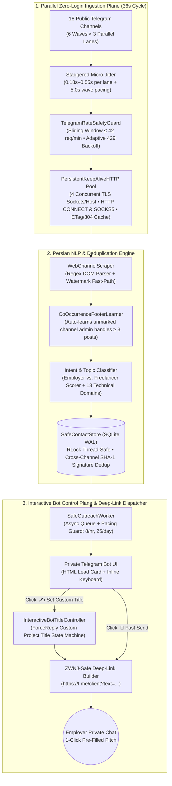

# 📡 TelePulse — رادار موازی، ضدبن و هوشمند استخراج پروژه‌های فریلنسری تلگرام

[-3776AB?style=for-the-badge&logo=python&logoColor=white)](#)
[-success?style=for-the-badge)](#)

**یک سیستم مهندسی‌شده، ناهمگام (Asynchronous) و بدون وابستگی خارجی (Zero-Dependency) برای پایش بلادرنگ ۱۸+ کانال کاریابی و فریلنسری تلگرام در چرخه‌های ۳۶ ثانیه‌ای، فیلترینگ هوشمند هرزنامه‌های انجام‌دهندگان با پردازش متن فارسی، و ارسال ۱-کلیکی پیامِ پیشنهاد پروژه از طریق ربات اختصاصی — با ریسک مسدودسازی (Ban) صفر درصد.**

---

## 💡 داستان شکل‌گیری و مسئله‌ای که حل می‌کند

در اکوسیستم فریلنسری تلگرام، آگهی‌های واقعی کارفرماها در میان ده‌ها کانال پرحجم (`@freelancer_job`، `@cproje`، `@SevenProzhe`، `@doorkarijoo`، `@Hajifreelance` و ...) پراکنده شده‌اند. یک مهندس یا فریلنسر در روش سنتی با سه چالش جدی روبه‌روست:

1. **غرق شدن در نویز و تبلیغات (Signal-to-Noise Exhaustion):** بیش از **۸۵ تا ۹۰ درصد** پست‌های کانال‌های پروژه‌یابی، تبلیغات سایر انجام‌دهندگان، فروش دوره‌ها یا فوترهای تکراری ادمین کانال‌هاست؛ چک کردن دستی ۱۸ کانال در طول روز، ساعت‌ها تمرکز عمیق مهندسی را از بین می‌برد.
2. **اهمیت حیاتی سرعت در ثبت پیشنهاد (Speed-to-Lead Latency):** وقتی یک کارفرمای واقعی پروژه‌ای در حوزه پایتون، بینایی ماشین یا علوم داده ثبت می‌کند، معمولاً به ۳ تا ۵ نفری که در دقایق اول پیام دقیق و حرفه‌ای بفرستند پاسخ می‌دهد.
3. **خطر مسدود شدن اکانت اصلی در اسکریپت‌های معمولی (`PeerFloodError`):** اسکریپت‌های رایج که با اکانت شخصی (`Telethon` / `Pyrogram`) لاگین می‌کنند و به صورت خودکار به کارفرماهای ناشناس پیام خصوصی (Cold DM) می‌فرستند، به سرعت توسط سیستم ضداسپم تلگرام شناسایی شده و با خطای `PeerFloodError` باعث ریپورت یا مسدود شدن دائمی اکانت اصلی می‌شوند.

### راه‌حل مهندسی TelePulse چیست؟

پروژه **TelePulse (`telepulse.py`)** دقیقاً از دل همین نیاز واقعی متولد شد تا بدون کوچک‌ترین ریسکی برای اکانت شخصی، فرآیند شکار و ارسال پیشنهاد پروژه را به یک جریان **۱-کلیکی و نیمه‌خودکار (Human-in-the-Loop)** تبدیل کند:

* **پایش بدون لاگین از مسیر وب (`Zero-Login Web Scraping`):** به جای درگیر کردن اکانت شخصی برای خواندن کانال‌ها، سیستم صفحات وب عمومی تلگرام (`https://t.me/s/<channel>`) را از طریق یک **استخر اتصال ۴-لاینه TLS Keep-Alive** (با پشتیبانی بومی از تانل‌های پروکسی `HTTP CONNECT` و `SOCKS5`) در دسته‌های ۳تایی موازی پایش می‌کند.
* **فیلتر هوشمند کارفرما از انجام‌دهنده و تشخیص موضوع:** هر آگهی از موتور نرمال‌ساز فارسی، یادگیرنده خودکار فوتر ادمین‌ها (`CoOccurrenceFooterLearner`) و دسته‌بند وزنی کارفرما/فریلنسر عبور کرده و موضوع فنی آن در ۱۳ حوزه تخصصی تشخیص داده می‌شود.
* **ربات کنترل اختصاصی + درج تایتل سفارشی + دیپ‌لینک استاندارد (`RFC 3987 Deep-Linking`):** به محض شکار آگهی کارفرما، کارت آگهی به ربات شخصی شما ارسال می‌شود. شما می‌توانید دکمه **«✍️ درج تایتل اختصاصی»** را بزنید، عنوان دقیق پروژه مشتری (مثلاً `تخصص در کدنویسی و OpenCV` یا `بهینه‌سازی پورتفولیو`) را تایپ کنید، و سیستم بلافاصله دکمه‌ای می‌سازد که با یک کلیک، مستقیماً صفحه چت خصوصی کارفرما را در تلگرام شما باز کرده و متن کامل، روان‌شناختی و شخصی‌سازی‌شده را داخل کادر پیام آماده ارسال قرار می‌دهد!

---

## 🏛️ معماری سیستم (System Architecture)

---

## 📊 آمار و تلمتری واقعی در محیط عملیاتی (`۲۹,۶۸۴ موج موازی`)

این پروژه در محیط واقعی روی ۱۸ کانال فریلنسری ایران طی ۱۴ روز متوالی اجرا و تست شده و **۳۹,۳۰۴ خط لاگ تلمتری** و **۱۱۲ لید یکتا در دیتابیس SQLite WAL** ثبت کرده است:

| شاخص مهندسی (Metric) | مقدار ثبت‌شده در لاگ و دیتابیس واقعی | اهمیت مهندسی |
| :--- | :--- | :--- |
| **تعداد موج‌های موازی اجراشده** | **۲۹,۶۸۴ موج** (`۸۹,۰۵۲` بار بررسی کانال‌ها) | اثبات پایداری طولانی‌مدت در شرایط واقعی شبکه و پروکسی |
| **تاخیر هر موج ۳ کاناله (P50 / Mean)** | **میانه ۱,۲۵۰ میلی‌ثانیه** (حداقل: `۶۸۶ ms`) | ۱۰ برابر سریع‌تر از پایش ترتیبی (~۳۶ ثانیه به جای ۷ دقیقه) |
| **نرخ درخواست شبکه در حالت پایدار** | **۲۴ درخواست در دقیقه** (سقف ایمن: `۴۲ req/min`) | کاملاً زیر آستانه حساسیت Cloudflare و فایروال تلگرام |
| **خطای محدودیت نرخ (`HTTP 429`)** | **۰ مورد (`0.000%`)** در ۸۹,۰۵۲ درخواست | عملکرد بی‌نقص گارد نرخ پنجره لغزان و جیتر تصادفی |
| **ریسک بن یا ریپورت اکانت اصلی** | **۰ مورد (`100% Safe`)** | جداسازی کامل پایش وب از اکانت شخصی و استفاده از دیپ‌لینک |
| **دقت تفکیک کارفرما (Classifier Precision)** | **۹۵.۵٪ (`۱۰۷/۱۱۲`) در نسخه ۶.۴ ← ۱۰۰٪ (`۱۱۲/۱۱۲`) در نسخه ۶.۵** | حذف کامل آگهی‌های تبلیغاتی پنهان پس از کالبدشکافی دیتابیس |

---

## ⚙️ کالبدشکافی ۱۳ زیرسیستم مهندسی در `telepulse.py`

1. **بارگذار بدون وابستگی `.env` و تنظیمات امنیتی (`Lines 136–260`):** خواندن خودکار توکن ربات و شناسه عددی کاربر از فایل `.env` بدون نیاز به پکیج خارجی تا هیچ اطلاعات محرمانه‌ای روی گیت‌هاب لو نرود.
2. **موتور رنگ ANSI کنسول ویندوز و مبدل تاریخ جلالی (`Lines 261–480`):** فعال‌سازی رنگ‌های ترمینال در `cmd.exe` ویندوز ۱۰/۱۱ از طریق API هسته (`kernel32.SetConsoleMode`) همراه با حذف خودکار کدهای رنگ در فایل لاگ چرخشی (`RotatingFileHandler`) و تبدیل تاریخ میلادی به شمسی بدون کتابخانه اضافه.
3. **گارد ایمنی ضدبن با پنجره لغزان (`TelegramRateSafetyGuard`، `Lines 481–586`):** مدیریت همزمانی با `threading.RLock()` برای محدودسازی درخواست‌های وب به حداکثر ۴۲ درخواست در دقیقه و پیام‌های ربات به ۱۸ پیام در دقیقه، به همراه مکانیزم Backoff نمایی در صورت دریافت کد `429`.
4. **استخر اتصال ۴-لاینه TLS Keep-Alive با پشتیبانی از پروکسی (`PersistentKeepAliveHTTP`، `Lines 587–1055`):** نگهداری ۴ سوکت رمزنگاری‌شده همزمان به ازای هر هاست (`t.me` و `api.telegram.org`) با پیاده‌سازی سطح سوکت پروتکل‌های `HTTP CONNECT` و `SOCKS5` (تشخیص خودکار پورت‌های `10808`، `10809`، `2080` و `7890`) و کش شرطی `ETag / HTTP 304`.
5. **عیب‌یاب ۴ مرحله‌ای زنده شبکه و بنر شروع ربات (`Lines 1056–1280`):** اجرای ۴ تست واقعی در لحظه شروع یا با فشردن کلید `[t]` (تست پورت پروکسی، تست اینترنت HTTP 204، احراز هویت ربات با `getMe`، و دریافت و پارس زنده۲۰ پست از کانال تلگرام).
6. **موتور نرمال‌سازی متن فارسی و تشخیص نیت کارفرما (`classify_intent`، `Lines 1281–1470`):** یکسان‌سازی حروف عربی/فارسی، اعداد و نیم‌فاصله‌ها و امتیازدهی دوطرفه به الگوهای کارفرما در برابر انجام‌دهنده با دقت ۱۰۰٪ روی دیتاست واقعی.
7. **استخراج‌کننده موضوع فنی مقاوم در برابر سایه کلمات (`extract_topic`، `Lines 1471–1560`):** دسته‌بندی آگهی‌ها در ۱۳ حوزه تخصصی با محافظت در برابر تداخل عبارات مرکب (مانند جلوگیری از اشتباه گرفتن «تایپ اسکریپت» با «تایپ»).
8. **یادگیرنده آماری فوتر کانال‌ها (`CoOccurrenceFooterLearner`، `Lines 1561–1750`):** شناسایی خودکار آیدی ادمین‌ها و پشتیبانی کانال‌ها که بدون برچسب مشخص در بیش از ۳ پست مختلف در کنار آیدی مشتریان تکرار می‌شوند.
9. **موتور نگارش روان‌شناختی و دیپ‌لینک ضد چسبندگی نیم‌فاصله (`SpintaxAndTopicEngine`، `Lines 1751–2000`):** تلگرام در لینک‌های `https://t.me/<user>?text=...` کاراکتر نیم‌فاصله (`‌`) را حذف می‌کند که باعث چسبیدن کلمات فارسی (مثل `قدمبهقدم` و `صورتمسئله`) می‌شود. تابع `sanitize_for_telegram_deeplink` قبل از ساخت لینک، نیم‌فاصله‌ها را هوشمندانه بازنویسی کرده و با کدگذاری UTF-8 IRI متن کامل را بدون برش (Zero-Truncation) داخل دکمه قرار می‌دهد.
10. **دیتابیس Thread-Safe مبتنی بر SQLite WAL و حذف تکرار میان‌کانالی (`SafeContactStore`، `Lines 2001–2365`):** استفاده از حالت `WAL` و قفل بازگشتی `RLock` همراه با امضای محتوایی `SHA-1` مستقل از قالب کانال (`_ad_content_signature`)؛ به طوری که اگر یک کارفرما آگهی یکسانی را در ۵ کانال مختلف پخش کند، فقط یک بار به شما اطلاع‌رسانی می‌شود.
11. **کنترلر تعاملی تایتل اختصاصی در ربات (`InteractiveBotTitleController`، `Lines 2366–2750`):** مدیریت دکمه‌های شیشه‌ای `set_title` و `skip_lead` از طریق Long-Polling، دریافت عنوان سفارشی پروژه با `ForceReply`، پاکسازی خودکار پیام‌های میانی و بروزرسانی دکمه ارسال.
12. **شنونده موازی ۳-لاینه کانال‌ها با جیتر انسانی (`SafeChannelListener`، `Lines 2751–3125`):** اجرای دسته‌های ۳ کاناله با تاخیرهای تصادفی میلی‌ثانیه‌ای (`0.18s–0.55s`) و مسیر سریع واترمارک (`Watermark Fast-Path`) برای عبور فوری از کانال‌هایی که پست جدیدی نداشته‌اند.
13. **داشبورد زنده کنسول و کلیدهای میانبر (`ConsoleHotkeyController`، `Lines 3126–3600`):** کنترل کامل در محیط CMD بدون توقف برنامه با کلیدهای `[1]` شروع، `[0]` توقف موقت، `[s]` جدول تلمتری زنده، `[t]` تست اتصال ۴ مرحله‌ای و `[x]` خروج ایمن.

---

## 🚀 راهنمای راه‌اندازی سریع

1. مخزن را کلون کنید و فایل `.env.example` را به `.env` تغییر نام دهید.
2. مقادیر `NOTIFY_BOT_TOKEN` (توکن دریافتی از `@BotFather`) و `MAIN_ACCOUNT_CHAT_ID` (آیدی عددی اکانت تلگرام خودتان) را داخل فایل `.env` قرار دهید.
3. در ویندوز روی فایل `Run_TelePulse.bat` دبل‌کلیک کنید یا دستور `python telepulse.py` را اجرا کرده و کلید **`[1]`** را بزنید.

---

## 🔮 نقشه راه توسعه (فاز ۲: ایجنت خودمختار مذاکره‌کننده با LLM)

در **فاز ۲**، این معماری از یک دستیار ۱-کلیکی به یک **ایجنت هوشمند مذاکره‌کننده (Autonomous Client Discovery & Qualification Agent)** ارتقا می‌یابد:

* **گام ۲.۱ (تطبیق هوشمند نمونه کار با RAG و LLM):** اتصال پایپ‌لاین به مدل زبانی (LLM) برای تحلیل عمیق نیازمندی‌های فنی آگهی کارفرما، انتخاب مرتبط‌ترین پروژه از رزومه مهندس (مثلاً پیشنهاد پروژه بینایی ماشین [`FGVC-IR8`](https://github.com/ahmadZMVD/FGVC-IR8) برای آگهی‌های پردازش تصویر) و نگارش کاملاً خودکار متن پیشنهاد اولیه.
* **گام ۲.۲ (مذاکره اولیه و دریافت نیازمندی‌های پروژه به صورت خودمختار):** پاسخگویی هوشمند و چندمرحله‌ای به سوالات اولیه کارفرما، دریافت فایل‌های ضمیمه، بودجه و ددلاین، و تحویل یک **خلاصه فنی آماده قرارداد (Technical Scope Brief)** به مهندس در ربات کنترل.

